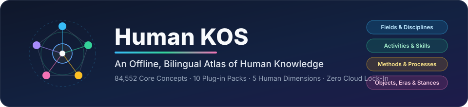
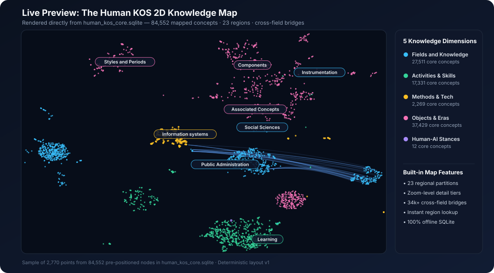
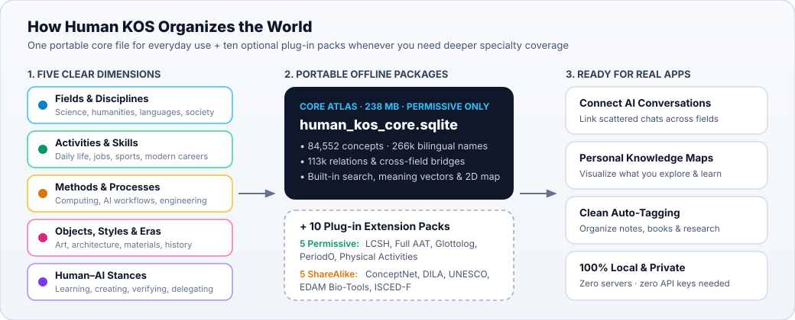

<div align="center">
  
</div>

<p align="center">
  <a href="./README.md"></a>
  <a href="./README_zh.md"></a>
</p>

<p align="center">
  <a href="https://github.com/CharlenaK/human-kos/releases/latest">
    
  </a>
  
  
  
  <a href="./LICENSE/">
    
  </a>
</p>

<h4 align="center">
  <a href="#-how-to-use--deploy">How to Use &amp; Deploy</a> |
  <a href="#-whats-included">Core &amp; Extension Packs</a> |
  <a href="#-documentation">Technical Docs</a> |
  <a href="./CONTRIBUTING.md">Contributing</a> |
  <a href="./LICENSE/">Licenses</a> |
  <a href="#-roadmap">Roadmap</a>
</h4>

<div align="center" style="margin-top:20px;margin-bottom:20px;">
  
</div>

<details open>
<summary><b>📕 Table of Contents</b></summary>

- 💡 [What is Human KOS?](#-what-is-human-kos)
- 🌟 [Key Highlights](#-key-highlights)
- 🔎 [How It Fits Together](#-how-it-fits-together)
- 📦 [What's Included](#-whats-included)
- 🚀 [How to Use &amp; Deploy](#-how-to-use--deploy)
- 📚 [Documentation](#-documentation)
- 🤝 [Contributing](#-contributing)
- ⚖️ [Licenses &amp; Attribution](#%EF%B8%8F-licenses--attribution)
- 📜 [Roadmap](#-roadmap)

</details>

## 💡 What is Human KOS?

**Human KOS** is a ready-to-use, completely offline atlas of human knowledge — organized into portable, single-file databases that open anywhere without servers, accounts, or cloud subscriptions.

Most notes, bookmarks, and AI conversations sit in isolated silos: a chat about architectural history never connects to urban design, and a discussion on music harmony stays separated from audio engineering. **Human KOS** gives your apps, AI assistants, and personal knowledge tools a shared, bilingual (Chinese & English) map of **what humans study, do, build, and explore** — complete with real cross-field bridges and ready-to-draw 2D map coordinates.

---

## 🌟 Key Highlights

### 🧭 **Five Clear Lenses on Human Knowledge**

Instead of dumping every word into one messy pile, Human KOS keeps five everyday questions cleanly separated:

- **Fields & Disciplines** — What area of knowledge is this? *(science, humanities, economics, world languages)*
- **Activities & Skills** — What are people doing or practicing? *(daily routines, professions, sports, emerging 2024–2025 roles)*
- **Methods & Processes** — How is the work done? *(computing methods, AI workflows, engineering techniques)*
- **Objects, Styles & Eras** — What concrete thing or historical period is involved? *(architecture, materials, art movements, timelines)*
- **Human–AI Stances** — How are human and AI working together? *(learning, iterating, verifying, delegating)*

### 🌉 **Real Bridges Across Disciplines**

- Built from authoritative open-access reference collections rather than noisy web scrapes.
- Connects related ideas across separate fields — linking, for example, *historical trade* with *regional economics*, *music theory* with *audio processing*, or *international relations* with *cybersecurity*.

### 🗺️ **A Ready-to-Render 2D Knowledge Map**

- Every concept in the Core Atlas already has a fixed 2D position, regional boundary, and zoom level.
- Build interactive knowledge maps, learning heatmaps, or visual explorers right out of the box — no heavy compute required.

### 🌏 **Built for Both Chinese & English**

- Over **266,000** Chinese and English names, aliases, and everyday expressions in the Core Atlas alone.
- Instant keyword lookup and meaning-based search work smoothly offline in both languages.

### 🔌 **One Portable Core + Ten Plug-in Packs**

- Start with a single **238 MB** core file (`human_kos_core.sqlite`) that covers everyday academic, professional, cultural, and technical topics.
- Attach any of the **10 optional specialty packs** whenever you need deeper coverage — from Library of Congress subject headings to art history, world languages, historical timelines, commonsense relations, or Buddhist historical studies.

### ⚖️ **Clean, Transparent Licensing**

- Every single entry knows exactly where it came from and under which license it is shared.
- The Core Atlas contains **only permissive open data** (no ShareAlike obligations). Packs with ShareAlike licenses are kept in separate, optional files so your project stays cleanly compliant.

---

## 🔎 How It Fits Together

<div align="center" style="margin-top:16px;margin-bottom:16px;">
  
</div>

---

## 📦 What's Included

All prebuilt database files are published under [**GitHub Releases (`v1.0.0`)**](https://github.com/CharlenaK/human-kos/releases/tag/v1.0.0).

### 1. Core Atlas *(Recommended Starting Point)*

| File | Size | Coverage | License |
| :--- | ---: | :--- | :--- |
| **`human_kos_core.sqlite`** | 238 MB | **84,552 core concepts** across all 5 dimensions, 266k bilingual names, cross-field bridges, meaning search & 2D map coordinates | Permissive Open Data ([details](./LICENSE/)) |

### 2. Optional Extension Packs *(Plug In Only What You Need)*

#### Permissive Packs *(No ShareAlike obligation)*

| Pack | Size | What It Adds | Upstream Source |
| :--- | ---: | :--- | :--- |
| **`lcsh.sqlite`** | 335 MB | 275k broad library subject headings across books, media & culture | Library of Congress (CC0) |
| **`aat.sqlite`** | 116 MB | 57k full art, architecture, design & material culture concepts (with Chinese labels) | Getty AAT (ODC-By 1.0) |
| **`glottolog.sqlite`** | 16 MB | 12.7k world language families and languages | Glottolog 5.4 (CC BY 4.0) |
| **`periodo.sqlite`** | 12 MB | 9.5k scholarly historical periods and dating ranges worldwide | PeriodO (CC0) |
| **`compendium.sqlite`** | 2.3 MB | 1.1k physical activities & sports with energy-expenditure intensity | Adult Compendium 2024 (CC BY 4.0) |

#### ShareAlike Packs *(Isolated optional files — see [`LICENSE/`](./LICENSE/))*

| Pack | Size | What It Adds | Upstream Source |
| :--- | ---: | :--- | :--- |
| **`dila.sqlite`** | 168 MB | 109k East Asian & Buddhist studies historical figures, places, and eras | DILA Authority Databases (CC BY-SA 3.0) |
| **`cn_rel.sqlite`** | 117 MB | 189k everyday action/purpose relations + 349k Chinese–English synonym bridges | ConceptNet 5.7 (CC BY-SA 4.0) |
| **`unesco.sqlite`** | 8.9 MB | 4.5k multilingual education, culture, science & policy vocabulary | UNESCO Thesaurus (CC BY-SA 3.0 IGO) |
| **`edam.sqlite`** | 5.3 MB | 2.3k bioinformatics operations, data formats & scientific workflows | EDAM Ontology 1.25 (CC BY-SA 4.0) |
| **`iscedf.sqlite`** | 0.7 MB | 219 international education & training field classifications | UNESCO ISCED-F 2013 (CC BY-SA 3.0 IGO) |

---

## 🚀 How to Use &amp; Deploy

Using **Human KOS** is as simple as downloading a regular file — **no cloud server, no Docker, and no database administration required**. Choose whichever way fits you best:

### Option A — Explore Visually with the Companion 2D Map App *(Easiest for Everyone)*

Want to browse all 84,552 concepts on an interactive 2D World Map and connect your AI chats?

1. **Download the Core Atlas file**: Go to [**GitHub Releases (`v1.0.0`)**](https://github.com/CharlenaK/human-kos/releases/latest) and download **`human_kos_core.sqlite`** (238 MB) into any folder on your computer.
2. **Start the companion visual app** ([**`human-kos-example`**](https://github.com/CharlenaK/human-kos-example)):
   ```bash
   git clone https://github.com/CharlenaK/human-kos-example.git
   cd human-kos-example/kos_engine
   uv sync
   uv run kos-engine --core /path/to/human_kos_core.sqlite serve --port 8787
   ```
3. **Open your browser**: Visit `http://127.0.0.1:8787/map`. You can zoom and explore the map, tag conversations across five dimensions, or plug it into **Open WebUI** without changing Open WebUI's code.

### Option B — Open the File Directly on Your Computer *(Zero App Setup)*

Just want to look inside the database or use it in your own script?

1. **Download the file** from [**Releases**](https://github.com/CharlenaK/human-kos/releases/latest), or run our one-line helper script (which checks file integrity automatically):
   ```bash
   # Download only the Core Atlas (~238 MB)
   python scripts/download_release.py --core-only

   # Or download the Core Atlas + all 10 specialty extension packs
   python scripts/download_release.py --all
   ```
2. **Take a 30-second tour** (requires only standard Python 3.9+, zero extra packages):
   ```bash
   python scripts/quick_demo.py data/human_kos_core.sqlite
   ```
   You can also double-click or drag `human_kos_core.sqlite` into any free desktop viewer such as [DB Browser for SQLite](https://sqlitebrowser.org/).

> **Adding extra packs later:** Simply place any optional `.sqlite` pack (such as `aat.sqlite` or `unesco.sqlite`) into a `human_kos_ext/` folder right next to `human_kos_core.sqlite` — both the companion app and our query examples detect them automatically.

---

## 📚 Documentation

To keep this page easy to scan, all technical specifications, query examples, and build internals live in [`docs/`](./docs/):

- [**Database Structure Reference**](./docs/SCHEMA.md) — Tables, fields, indexes, and coordinate/vector contracts
- [**Standalone Query Cookbook**](./docs/QUERIES.md) — Ready-to-run search, multi-hop graph, map viewport, and extension-pack examples
- [**Quality &amp; Verification Report**](./docs/ACCEPTANCE.md) — Automated benchmark results, latency metrics, and compliance checks
- [**Offline Build Guide**](./docs/BUILD.md) — How to reproduce the entire atlas offline from upstream open datasets
- [**Integrity Manifest**](./docs/MANIFEST.json) &amp; [**SHA-256 Checksums**](./docs/SHA256SUMS.txt) — Exact file hashes and provenance summaries

---

## 🤝 Contributing

We welcome contributions of all kinds — better Chinese/English labels, data-quality bug reports, suggestions for authoritative open-access vocabularies, and new companion adapters!

See [**`CONTRIBUTING.md`**](./CONTRIBUTING.md) for guidelines on keeping the Atlas client-agnostic and respecting open-data license boundaries.

---

## ⚖️ Licenses &amp; Attribution

All licensing documents, full upstream legal texts, and required credit notices are collected in the dedicated **[`LICENSE/`](./LICENSE/)** folder:

- **Repository code, scripts &amp; docs**: [MIT License](./LICENSE/MIT.txt)
- **Data license matrix &amp; isolation guide**: [`LICENSE/README.md`](./LICENSE/README.md)
- **Full upstream attribution list**: [`LICENSE/NOTICE.md`](./LICENSE/NOTICE.md)

---

## 📜 Roadmap

- **Phase 1 — Knowledge Atlas Base (`v1.0.0`)** ✅ *Completed*
  - Core bilingual knowledge atlas (`human_kos_core.sqlite`), 2D map coordinates, and 10 license-isolated extension packs.
- **Phase 2 — Client-Agnostic Adapter Contract (`L2` Design)** ✅ *Completed*
  - Defined the six-domain read-only Adapter Contract (isolated 5-facet hybrid search, multi-hop traversal with negative-edge &amp; IC guards, provenance checks, and R\*Tree/Voronoi viewport).
- **Phase 3 — Reference Example App &amp; Personal Bridge (`L2 + L3`)** ✅ *Completed*
  - Published in companion repository [**`CharlenaK/human-kos-example`**](https://github.com/CharlenaK/human-kos-example): standalone local engine (`kos-engine`), interactive 2D Knowledge World Map, private local ledger (`personal_bridge.sqlite`), and zero-fork Open WebUI integration kit.
