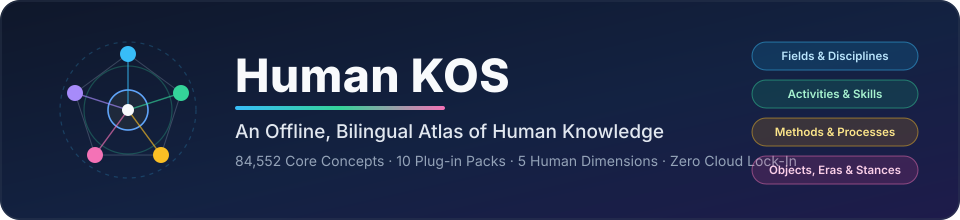
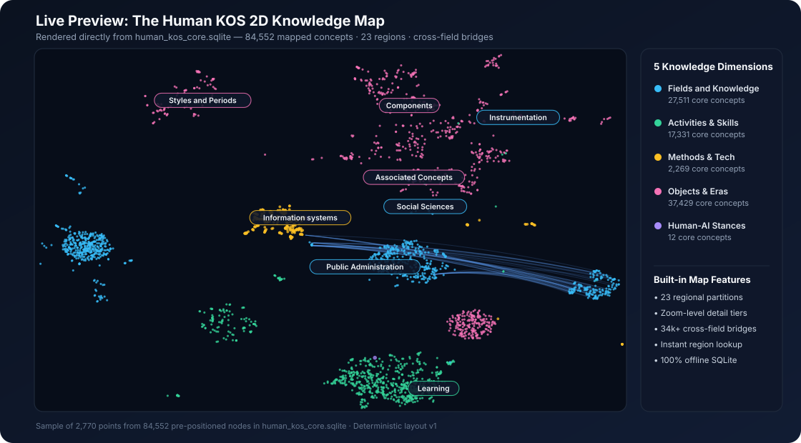
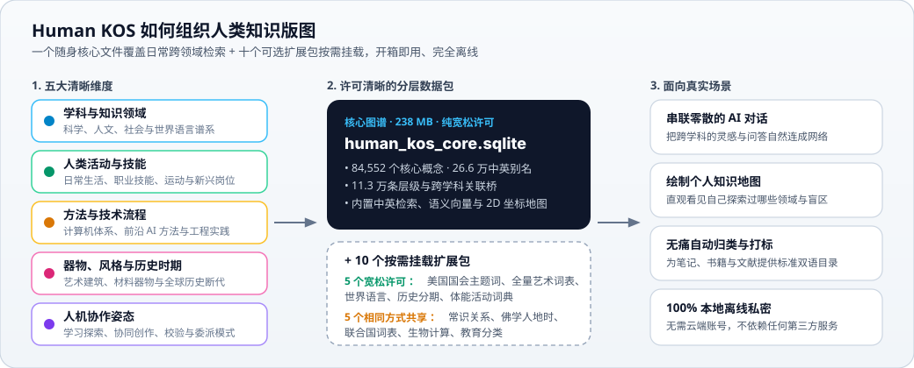

<div align="center">
  
</div>

<p align="center">
  <a href="./README.md"></a>
  <a href="./README_zh.md"></a>
</p>

<p align="center">
  <a href="https://github.com/CharlenaK/human-kos/releases/latest">
    
  </a>
  
  
  
  <a href="./LICENSE/">
    
  </a>
</p>

<h4 align="center">
  <a href="#-%E5%BF%AB%E9%80%9F%E5%BC%80%E5%A7%8B">快速开始</a> |
  <a href="#-%E5%8C%85%E5%90%AB%E5%86%85%E5%AE%B9">核心与扩展包</a> |
  <a href="#-%E6%8A%80%E6%9C%AF%E6%96%87%E6%A1%A3">技术文档</a> |
  <a href="./LICENSE/">许可与致谢</a> |
  <a href="#-%E8%B7%AF%E7%BA%BF%E5%9B%BE">路线图</a>
</h4>

<div align="center" style="margin-top:20px;margin-bottom:20px;">
  
</div>

<details open>
<summary><b>📕 目录</b></summary>

- 💡 [Human KOS 是什么？](#-human-kos-是什么)
- 🌟 [核心亮点](#-核心亮点)
- 🔎 [全景一览](#-全景一览)
- 📦 [包含内容](#-包含内容)
- 🚀 [快速开始](#-快速开始)
- 📚 [技术文档](#-技术文档)
- ⚖️ [许可协议与致谢](#%EF%B8%8F-许可协议与致谢)
- 📜 [路线图](#-路线图)

</details>

## 💡 Human KOS 是什么？

**Human KOS** 是一套开箱即用、完全离线运行的中英双语人类知识图谱底座——全部内容打包为可随身携带的单文件数据库，无需服务器、无需云端账号，也不依赖任何第三方插件。

日常的笔记、书签与 AI 对话往往散落在各自的孤岛里：聊建筑史的对话不会自动连向城市设计，学乐理和弦的问答也很难关联到音频工程。**Human KOS** 为 AI 助手、个人知识库与研究工具提供一张共享的“人类知识世界地图”——清晰描绘**人类在研究什么、做什么、用什么方法、创造过哪些器物与时代**，并自带跨学科关联桥与现成的二维地图坐标。

---

## 🌟 核心亮点

### 🧭 **五个清晰维度，告别杂乱标签**

Human KOS 不把所有词条混成一团，而是按人们最自然的五个视角分层组织：

- **学科与知识领域** — 这件事属于哪一门学问？（自然科学、人文社科、经济学、世界语言谱系）
- **人类活动与技能** — 人们在做什么、练什么？（日常生活、职业技能、体能运动、2024–2025 新兴岗位）
- **方法与技术流程** — 具体用什么方法完成？（计算机体系、前沿 AI 方法、工程与科研流程）
- **器物、风格与历史时期** — 涉及哪些具象事物或历史断代？（建筑艺术、材料工艺、全球历史分期）
- **人机协作姿态** — 人与 AI 处于哪种配合状态？（学习探索、协同迭代、结果校验、任务委派）

### 🌉 **打通真实世界的跨学科关联**

- 汇聚全球权威开放词表与分类体系，拒绝嘈杂的网页抓取噪音。
- 内置数万条真实的跨学科关联桥——能自然把*地方历史*连向*区域经济*、把*乐理分析*连向*音频处理*、把*国际关系*连向*网络安全*。

### 🗺️ **开箱即用的二维知识地图**

- 核心图谱里的每一个概念都已经算好固定的二维坐标、区域边界与缩放层级。
- 无需昂贵算力，即可直接用于绘制个人学习地图、兴趣星图或交互式知识浏览器。

### 🌏 **原生中英双语体验**

- 仅核心图谱就包含超过 **26.6 万条**中英文标准名称、别名与日常表达。
- 无论是中文关键词检索还是跨语言语义联想，都能在本地毫秒级离线响应。

### 🔌 **一个轻量核心 + 十个按需扩展包**

- 起步只需一个 **238 MB** 的核心文件（`human_kos_core.sqlite`），即可覆盖绝大多数跨学科、职业技能、文化艺术与科技话题。
- 需要更深入的专业领域时，可随时按需挂载 **10 个独立扩展包**——涵盖美国国会主题词、全量艺术与建筑词表、世界语言、历史断代、日常常识关系乃至东亚佛学人地时典据。

### ⚖️ **边界透明、放心复用的许可体系**

- 每一条概念与关系都清晰记录原始出处与许可协议。
- 核心图谱**仅纳入宽松开放许可数据**，不含任何“相同方式共享（ShareAlike）”传染性条款；带有 ShareAlike 要求的扩展包全部物理隔离为独立文件，按需选用、合规无忧。

---

## 🔎 全景一览

<div align="center" style="margin-top:16px;margin-bottom:16px;">
  
</div>

---

## 📦 包含内容

全部预构建数据库文件均发布在 [**GitHub Releases (`v1.0.0`)**](https://github.com/CharlenaK/human-kos/releases/tag/v1.0.0)。

### 1. 核心图谱（推荐起步首选）

| 文件 | 体积 | 内容概览 | 许可类型 |
| :--- | ---: | :--- | :--- |
| **`human_kos_core.sqlite`** | 238 MB | **84,552 个核心概念**（覆盖全部 5 大维度）、26.6 万中英别名、跨学科关联桥、离线语义检索与 2D 地图坐标 | 纯宽松开放许可（[详见 LICENSE/](./LICENSE/)） |

### 2. 按需挂载扩展包（全量 10 个）

#### 宽松许可扩展包（无 ShareAlike 约束）

| 扩展包 | 体积 | 补充内容 | 上游来源 |
| :--- | ---: | :--- | :--- |
| **`lcsh.sqlite`** | 335 MB | 27.5 万条广覆盖图书、文化与社会主题词 | 美国国会图书馆 LCSH（CC0） |
| **`aat.sqlite`** | 116 MB | 5.7 万条全量艺术、建筑、器物与材料词表（含中文标签） | Getty AAT（ODC-By 1.0） |
| **`glottolog.sqlite`** | 16 MB | 1.27 万条世界语系与语言谱系 | Glottolog 5.4（CC BY 4.0） |
| **`periodo.sqlite`** | 12 MB | 9.5 千条全球权威历史分期与起止年代 | PeriodO（CC0） |
| **`compendium.sqlite`** | 2.3 MB | 1.1 千项体能活动与运动强度（含代谢当量） | Adult Compendium 2024（CC BY 4.0） |

#### 相同方式共享（ShareAlike）独立扩展包（物理隔离，详见 [`LICENSE/`](./LICENSE/)）

| 扩展包 | 体积 | 补充内容 | 上游来源 |
| :--- | ---: | :--- | :--- |
| **`dila.sqlite`** | 168 MB | 10.9 万条东亚历史与佛学人物、地名与时间典据 | 法鼓文理学院 DILA（CC BY-SA 3.0） |
| **`cn_rel.sqlite`** | 117 MB | 18.9 万条日常动作/用途常识关系 + 34.9 万条中英同义桥 | ConceptNet 5.7（CC BY-SA 4.0） |
| **`unesco.sqlite`** | 8.9 MB | 4.5 千条多语教育、文化、科技与政策主题词 | 联合国教科文组织词表（CC BY-SA 3.0 IGO） |
| **`edam.sqlite`** | 5.3 MB | 2.3 千条生物信息学操作、数据格式与科研流程 | EDAM 1.25（CC BY-SA 4.0） |
| **`iscedf.sqlite`** | 0.7 MB | 219 项国际教育与培训学科分类 | UNESCO ISCED-F 2013（CC BY-SA 3.0 IGO） |

---

## 🚀 快速开始

无需部署服务端、Docker 或任何数据库扩展，本地有 Python 3.9+（或任意 SQLite 浏览器）即可直接体验。

### 1. 下载数据库文件

可直接前往 [**Releases 页面**](https://github.com/CharlenaK/human-kos/releases/latest)手动下载，也可运行仓库自带的一键下载与校验脚本：

```bash
# 仅下载核心图谱（约 238 MB）
python scripts/download_release.py --core-only

# 下载核心图谱 + 全部 10 个扩展包
python scripts/download_release.py --all
```

### 2. 三十秒快速体验

```bash
python scripts/quick_demo.py data/human_kos_core.sqlite
```

只需这两步，你就能在完全离线的本地环境里浏览与检索 8.4 万个相互关联的人类知识概念。

---

## 📚 技术文档

为降低首页阅读压力，全部表结构、查询示例、验收指标与离线重建说明均收纳在 [`docs/`](./docs/) 目录中：

- [**数据库结构说明**](./docs/SCHEMA.md) — 完整表设计、字段约定、索引与坐标/向量规格
- [**独立查询示例集**](./docs/QUERIES.md) — 开箱即用的双语检索、多跳跨领域游走、地图视口与扩展包挂载示例
- [**质量与验收报告**](./docs/ACCEPTANCE.md) — 检索延迟实测、跨领域连通率与全项合规检验结果
- [**离线重建与开发指南**](./docs/BUILD.md) — 如何从上游开放数据集完全离线、确定性地重建全部产物
- [**文件清单**](./docs/MANIFEST.json) 与 [**SHA-256 校验值**](./docs/SHA256SUMS.txt) — 全量产物哈希与溯源摘要

---

## ⚖️ 许可协议与致谢

本项目专门设立了 **[`LICENSE/`](./LICENSE/)** 文件夹，集中存放代码协议、分级数据许可说明、全部上游完整法律文本与署名清单：

- **仓库代码、脚本与文档**：[MIT 许可协议](./LICENSE/MIT.txt)
- **数据许可分级与隔离指南**：[`LICENSE/README.md`](./LICENSE/README.md)
- **完整上游数据源署名清单**：[`LICENSE/NOTICE.md`](./LICENSE/NOTICE.md)

---

## 📜 路线图

- **第一阶段 — 人类知识图谱底座（`v1.0.0`）** ✅ *已完成*
  - 发布中英双语核心图谱（`human_kos_core.sqlite`）、内置二维知识地图坐标与 10 个许可隔离扩展包。
- **第二阶段 — 智能语义挂载层（`L2`）** 🔜 *规划中*
  - 将零散对话、笔记与文档自动映射到五大知识维度，提供混合召回与轻量级精准重排。
- **第三阶段 — 个人知识桥接层（`L3`）** 🔜 *规划中*
  - 在本地将个人历史对话与知识库投影到 Human KOS 地图上，确保个人隐私数据与公共图谱始终物理隔离。
